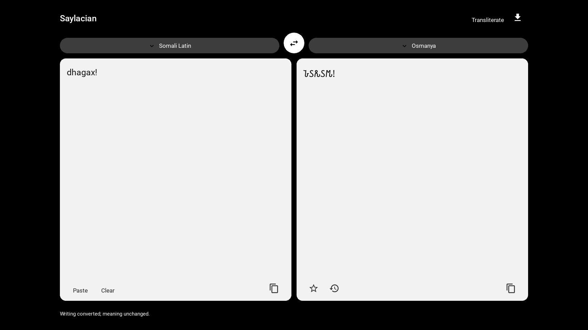
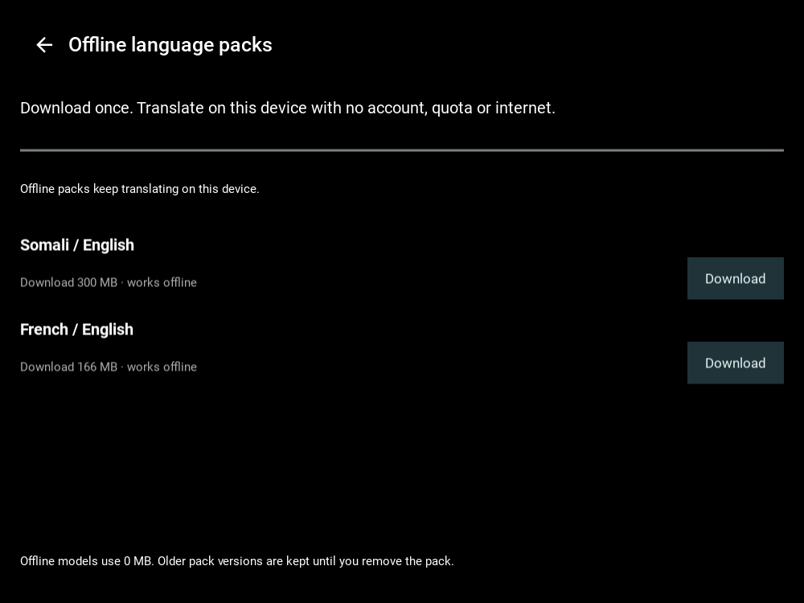

# Saylacian

Saylacian is a free Python/Kivy language and script-preservation app. It combines local translation packs with experimental script conversion for Windows. Translation runs on-device after the relevant pack is installed; local use has no account, quota, subscription, or per-translation charge.



## What works

| Feature | Status |
|---|---|
| English ↔ French meaning translation | Offline model route; smoke-tested |
| English → Somali Latin | The downloadable pack uses the multilingual fallback; locally prepared builds may also use the guarded synthetic candidate. Both are experimental and need fluent review |
| Somali Latin → English | Experimental local model; fluent review needed |
| Somali ↔ French | Experimental two-step route through English; errors can compound |
| Somali Latin ↔ Osmanya | Experimental script conversion; not meaning translation |
| Borama/Kaddare | Experimental partial chart-based mappings; not standardized Unicode text |
| Old Nubian | Limited Coptic-script to scholarly Latin transliteration; reverse conversion is experimental. This does not translate Old Nubian meaning or cover all conventions. |
| Modern Nubian varieties | Unsupported; each variety and orthography needs separate research and review. |

Somali meaning translation has not had fluent-speaker review. Borama and Kaddare use partial mappings transcribed from historical charts; they are experimental, not standardized Unicode text, and do not establish accepted spelling or general orthography. The limited Old Nubian route is a character transliteration table, not evidence of complete or fluent Old Nubian support. Modern Nubian varieties are not implemented. These labels describe code and evidence, not validated translation quality. Full coverage and limitations: [support matrix](docs/SUPPORT_MATRIX.md), [script feasibility](docs/SCRIPT_FEASIBILITY.md), [quality evidence](docs/SOMALI_TRANSLATION_QUALITY.md), and [project status](docs/PROJECT_STATUS.md).

## Install and run on Windows

Use Python 3.12. From a clean checkout in PowerShell:

```powershell
py -3.12 -m venv .venv
.\.venv\Scripts\python.exe -m pip install -r requirements-runtime-lock.txt
.\.venv\Scripts\python.exe main.py
```

No PowerShell activation or execution-policy change is required. Flask belongs to the optional website and is not needed for the Kivy app.

To run the separate legacy website, install `requirements-website.txt` and use `python run_website.py`.

## Download offline packs

Open **Offline language packs** in the app and choose Download for the required pair. Review the displayed download size first. Downloads are opt-in, pinned to upstream revisions, checked against SHA-256, versioned, and stored in the user's application data directory. Packs can be removed to reclaim space. After installation, choose the offline provider and translation works without internet; local translations have no artificial daily limit.

Current download sizes:

- Somali / English: about 300 MiB.
- French / English: about 166 MiB.

An offline pack contains two directional models. The Somali pack uses the smaller multilingual models; the higher-scoring synthetic English→Somali candidate is not currently part of that download. English↔Somali quality is experimental. Model licence and runtime metadata are recorded in the manifests and installed pack record. Full setup and troubleshooting: [RUN.md](RUN.md) and [offline packs](docs/OFFLINE_PACKS.md).



## Development

```powershell
py -3.12 -m venv .venv
.\.venv\Scripts\python.exe -m pip install -r requirements-dev.txt
.\.venv\Scripts\python.exe -m pytest -q
.\.venv\Scripts\python.exe -m compileall -q main.py app saylacian tools tests
.\.venv\Scripts\ruff.exe check --select E9,F63,F7,F82 main.py app saylacian tools tests
.\.venv\Scripts\python.exe tools\check_release_safety.py
```

The test suite and CI do not download model weights. To reproduce a full local model install, run `tools/prepare_models.py` as documented in [RUN.md](RUN.md); this downloads large model files. Do not commit models or credentials.

See [CONTRIBUTING.md](CONTRIBUTING.md) for code and linguistic review expectations. Historical models, datasets, and scripts require source, version, licence, and checksum evidence before inclusion.

## Privacy, platform, and release

Offline translation stays on-device. Optional online providers are user-configured enhancements and are not required for local translation. Review [online provider behavior](docs/ONLINE_TRANSLATION.md) before enabling one. Android and iOS builds are not verified; see [mobile runtime status](docs/MOBILE_RUNTIME_STATUS.md).

Saylacian's initial source snapshot was published to the public [GitHub repository](https://github.com/zealousvec/Saylacian) on 2026-10-24 as an experimental alpha. Saylacian-authored code that the project licensor owns is licensed under GNU AGPL version 3 or (at your option) any later version (SPDX: `AGPL-3.0-or-later`). The complete official text is in [LICENSE](LICENSE). This grant does not cover third-party code or independently licensed fonts, chart-derived data, datasets, or model weights; their terms and notices remain separate in [third-party notices](docs/THIRD_PARTY_NOTICES.md). Public Windows installers and verified mobile releases are not available.
