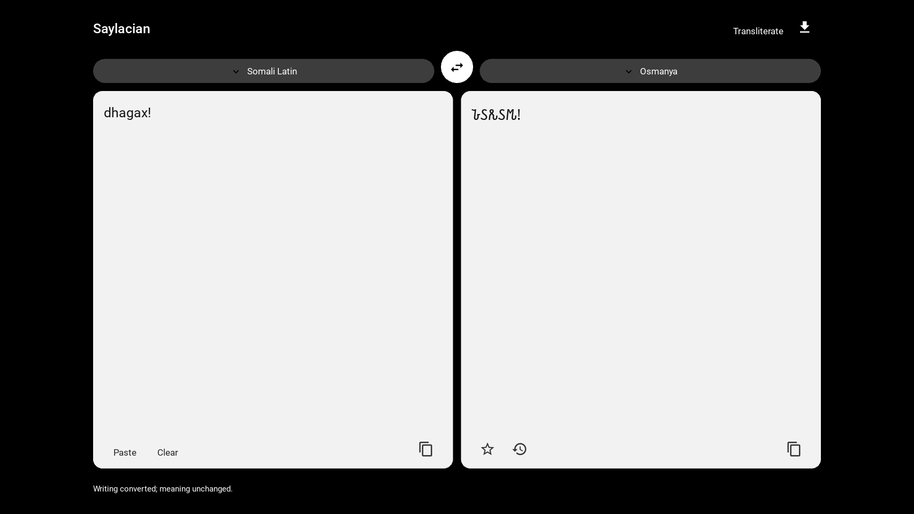

# Saylacian

A Python desktop app for offline translation and script conversion, with a focus
on Somali writing systems and a limited Old Nubian reading reference.



[](https://github.com/zealousvec/Saylacian/actions/workflows/ci.yml) [](https://www.python.org/downloads/) [](LICENSE)

**Alpha software · version 0.1.0a1 · Windows source installation.**
No verified Windows binary release is available. Somali translation and
historical-script readings need linguistic review.

## Features

- Translate locally after installing the relevant offline language packs.
- Convert supported scripts, with warnings and alternative readings where input
  is ambiguous.
- Browse the Old Nubian character reference and save paired reading records.
- Use the desktop app, shared Python core or optional local Flask website.

## Languages and scripts

| Meaning translation | Support |
|---|---|
| English ↔ French | Offline models |
| English ↔ Somali Latin | Offline models; alpha quality |
| French ↔ Somali Latin | Two-step route through English; errors can compound |

| Script conversion | Scope |
|---|---|
| Somali Latin ↔ Osmanya | Listed character mappings; reverse readings can be ambiguous |
| Somali Latin ↔ Borama / Kaddare | Partial historical-chart mappings; require bundled fonts and use private-use characters |
| Old Nubian Coptic script ↔ scholarly Latin | Limited 29-character table and alternative reverse parses; not meaning translation |

Modern Nubian varieties are not supported. See the [support matrix](docs/SUPPORT_MATRIX.md)
for route details and the [letter guide](docs/SCRIPT_LETTER_GUIDE.md) for mapping limits.

## Install and run

Requires **64-bit Python 3.12** on Windows. In PowerShell:

```powershell
git clone https://github.com/zealousvec/Saylacian.git
cd Saylacian
py -3.12 -m venv .venv
.\.venv\Scripts\python.exe -m pip install -r requirements-runtime-lock.txt
.\.venv\Scripts\python.exe main.py
```

No virtual-environment activation or execution-policy change is needed.
For troubleshooting and optional runtimes, see [RUN.md](RUN.md).

To use the separate local website:

```powershell
.\.venv\Scripts\python.exe -m pip install -r requirements-website.txt
.\.venv\Scripts\python.exe run_website.py
```

Open `http://127.0.0.1:5000` in your browser. The website does not require Kivy
to be running and is not a public hosted service.

## Offline translation

Open **Offline language packs** in the desktop app to install a pack. French ↔
English downloads about **166 MiB**; Somali ↔ English about **300 MiB**. Downloads
are opt-in, versioned and checked against pinned SHA-256 hashes. Installed packs
are stored in your application data folder and can be removed from the app.

After installation, the offline provider runs without an account or a network
connection. Optional larger AfriSLM packs require a separate runtime; see
[offline packs](docs/OFFLINE_PACKS.md) and [translation setup](docs/TRANSLATION_FEASIBILITY.md).
Online providers are optional and user-configured; review their
[privacy behavior](docs/ONLINE_TRANSLATION.md) before enabling one.

## Alpha limitations

Somali output can be incorrect. Script conversion does not establish accepted
word spelling, and the Old Nubian reference is not complete manuscript coverage
or specialist-validated interpretation. Check important results with a qualified
speaker or reader.

Android and iOS builds are unverified. Windows binary distribution remains
blocked by runtime and dependency-provenance checks. See the
[current project status](docs/PROJECT_STATUS.md) and [changelog](CHANGELOG.md).

## Documentation

- [User guide](docs/USER_GUIDE.md) — navigation, reading tools and clipboard behavior.
- [Documentation index](docs/README.md) — setup, architecture and source references.
- [Python and HTTP API](docs/API_REFERENCE.md) — use the shared core or local service.
- [Independent research runner](research/README.md) — bounded checks, checkpoints and evaluation.

## Contributing and licence

Bug reports, documentation fixes and source-backed linguistic review are welcome.
Read [Contributing](CONTRIBUTING.md), the [Code of Conduct](CODE_OF_CONDUCT.md)
and the [security policy](SECURITY.md) before submitting.

Saylacian-authored code is **AGPL-3.0-or-later**; see [LICENSE](LICENSE).
Third-party models, fonts and chart-derived assets retain their own terms.
The [third-party notices](docs/THIRD_PARTY_NOTICES.md) credit the upstream work,
including Kivy, translation-model projects, Noto fonts and historical-script sources.
Project attribution is recorded in [AUTHORS.md](AUTHORS.md).
